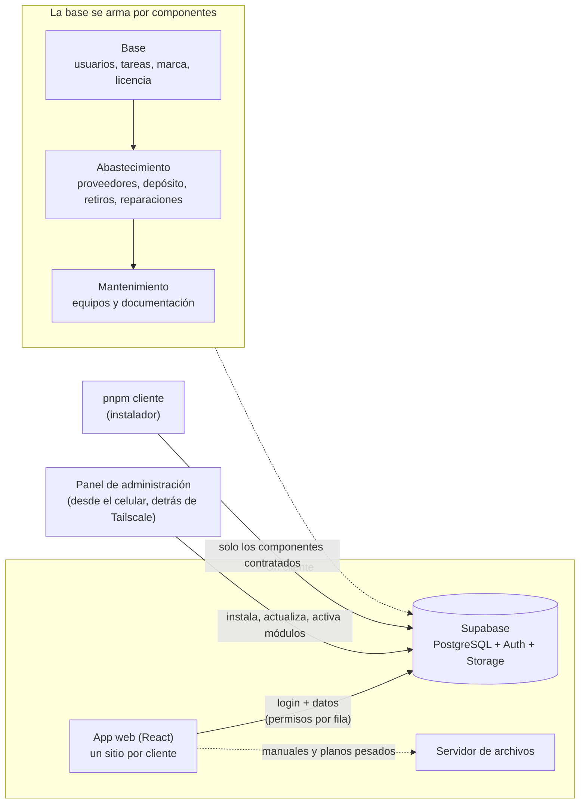

# Gestión empresarial

Plantilla de aplicación interna para empresas, por módulos: proveedores, comisionistas, envíos con rótulos, depósito (repuestos, stock, retiros, ajustes, reposición y reparaciones: lo que se manda a reparar afuera), mantenimiento (equipos) y tareas. Cada cliente recibe solo los módulos que contrata. Los datos propios de cada empresa (nombre, logo, dirección, diseño de rótulos) se cargan desde **Configuración**, no están en el código.

> **Estado:** plantilla en construcción, derivada de una instalación real. La base de datos se arma por componentes y se instala
> sin datos con un solo comando (ver [docs/NUEVO-CLIENTE.md](docs/NUEVO-CLIENTE.md)), o desde el panel de administración. Lo que falta para ofrecerla a
> otras empresas está en [docs/PENDIENTES.md](docs/PENDIENTES.md).

## Documentación

- [**Manual paso a paso** (instalar, módulos, permisos, entrega, problemas)](docs/MANUAL-PASO-A-PASO.md)
- [Instalar y actualizar un cliente (versión corta)](docs/NUEVO-CLIENTE.md)
- [Arquitectura](docs/ARQUITECTURA.md)
- [Componentes, módulos y licencia](docs/COMPONENTES.md)
- [Agregar un módulo nuevo](docs/NUEVO-MODULO.md)
- [Seguridad y permisos](docs/SEGURIDAD.md)
- [Auditoría de la base de datos (hallazgos, OWASP y fases)](docs/AUDITORIA-BASE-DE-DATOS.md)
- [Pruebas: qué hay, qué cubre y qué no](docs/PRUEBAS.md)
- [**Rendimiento: un pilar del producto** (qué se exige, qué se midió, qué se corrigió y qué falta)](docs/RENDIMIENTO.md)
- [Escala: metas y reglas](docs/ESCALA.md)
- [Trabajar con alguien que desarrolla solo las pantallas](docs/DESARROLLO-CON-SOCIO.md)
- [Plan del producto (hacia dónde crece)](docs/PLAN-PRODUCTO.md)
- [Pendientes para que sea un producto](docs/PENDIENTES.md)
- **Panel de administración de clientes (carpeta `panel/`)**: [diseño](docs/PANEL-DISENO.md) · [informe de seguridad](docs/PANEL-SEGURIDAD.md) · [instalación paso a paso](docs/PANEL-INSTALACION.md)
- [Servidor de archivos](servidor-manuales/README.md)

## Tecnología

- React 19 + TypeScript (modo estricto) + Vite 8, Tailwind 4 y Radix
- Supabase (base PostgreSQL, login, Storage y Edge Functions); los permisos los hace cumplir la base (RLS), no la pantalla
- TanStack Query para datos, Vitest y Playwright para pruebas, axe para accesibilidad, Oxlint para lint
- Tipografías propias (Nunito y Playfair Display) servidas desde la app, sin depender de Google

## Cómo está armado



El mismo código sirve a todos los clientes: lo propio de cada uno (nombre, logo, colores, módulos, claves) vive en su proyecto de Supabase.
Un módulo funciona si la licencia lo incluye **y** el dueño no lo apagó; la base de cada cliente tiene solo las tablas de lo que contrató.

## Calidad, medida

| Qué se cuida | Cómo | Resultado |
|---|---|---|
| Permisos y seguridad de los datos | Cada configuración posible de usuario (272) × 120 operaciones, contra una base PostgreSQL real en memoria | 32.640 comprobaciones, 0 diferencias |
| Módulos y planes | 71 combinaciones de módulos; 16 estados de licencia × 33 usuarios × 120 operaciones | 3.220 y 63.360, 0 diferencias |
| Todo lo que depende de la hora | Fecha local en 23 zonas horarias, tareas, vencimientos | 12.581, 0 diferencias |
| La base desde cero y al actualizar | Instalación por componentes = instalación original; ampliar sin perder datos | idénticas |
| Lógica de la app | Vitest | 124 pruebas |
| La app en un navegador de verdad | Playwright: entrar, retirar y devolver stock, recibir una reparación, editar contactos, en computadora y celular | pasan |
| Accesibilidad | axe (WCAG 2.1 AA) en cada pantalla y pestaña, y en el menú del celular | 0 problemas |
| Velocidad | Búsqueda en memoria medida con 5.000, 20.000 y 50.000 repuestos; el arranque no repite ningún pedido | peor caso 55 ms con 50.000 |
| Concurrencia y carga | Decenas de personas a la vez (buscan, editan, retiran, ajustan, crean, borran) contra una **PostgreSQL real**; el stock sale exacto, sin retiros a medias, sin bloqueos mutuos ni códigos repetidos | antes: 37 bloqueos y stock equivocado; ahora: 0 ([detalle](docs/RENDIMIENTO.md)) |
| Escala de la base | Datos sintéticos (cientos de miles de filas) y las consultas de la app con las reglas de seguridad puestas; ninguna clave foránea sin índice | el historial de retiros pasó de 99 s a 0,2 s con 100.000 retiros ([detalle](docs/ESCALA.md)) |
| Panel de administración | Pruebas de ataque (autenticación, sesiones, CSRF, entradas, concurrencia) | 610 |

Todo corre solo en cada cambio (GitHub Actions) y nada de esto toca un proyecto real de Supabase. Detalle en [docs/PRUEBAS.md](docs/PRUEBAS.md).

## Puesta en marcha

Requisitos: Node.js 20.19 o superior y [pnpm](https://pnpm.io) (`npm install -g pnpm`).

```bash
pnpm install
```

Copiar `.env.example` a `.env` y completar las dos variables (ver abajo). Después:

```bash
pnpm dev
```

### Variables de entorno (`.env`)

| Variable | Qué es |
|---|---|
| `VITE_SUPABASE_URL` | Dirección del proyecto de Supabase |
| `VITE_SUPABASE_ANON_KEY` | Clave pública ("publishable") del proyecto |

El archivo `.env` no se sube a git. En producción se configuran como variables del servicio de hosting.

Variables opcionales para Sentry (reporte de errores):

| Variable | Qué es |
|---|---|
| `VITE_SENTRY_DSN` | Dirección del proyecto de Sentry. Sin ella no se envían errores |
| `SENTRY_AUTH_TOKEN`, `SENTRY_ORG`, `SENTRY_PROJECT` | Solo en el hosting. Con las tres, cada build sube a Sentry los mapas de código y los borra de lo publicado. El token es secreto |

## Comandos

| Comando | Qué hace |
|---|---|
| `pnpm dev` | Servidor de desarrollo |
| `pnpm build` | Chequea tipos y genera la versión de producción en `dist/` |
| `pnpm lint` | Revisa el código con Oxlint |
| `pnpm test` | Corre las pruebas de la lógica |
| `pnpm pruebas:pantalla` | Abre la app en un navegador y prueba los flujos reales y la accesibilidad (arranca solo un Supabase local de ejemplo) |
| `pnpm cliente nuevo ...` | Crea el proyecto de Supabase de un cliente nuevo y lo deja instalado |
| `pnpm cliente actualizar --ref ...` | Aplica a un cliente las migraciones y funciones nuevas |
| `pnpm cliente modulos --ref ...` | Ve y cambia los módulos que tiene contratados un cliente (solo lo hace quien vende) |
| `pnpm cliente componente --ref ... --agregar ...` | Instala en un cliente un componente que no tenía (por ejemplo, Mantenimiento) sin tocar sus datos |
| `pnpm pruebas:esquema` | Prueba la base de datos desde cero en memoria: cadena original, cadena por componentes y equivalencia entre las dos |
| `pnpm pruebas:supabase-local` | La prueba de integración, el instalador, las combinaciones de módulos, la lógica y los 32.640 permisos, contra un Supabase local simulado (sin tocar proyectos reales) |
| `pnpm pruebas:integracion ...` | Prueba de punta a punta de una instalación de pruebas (contra un proyecto real de Supabase de pruebas) |

El panel de administración (carpeta `panel/`) tiene sus propios comandos: dentro de `panel/`, `pnpm test`, `pnpm run typecheck` y `pnpm build` (ver [docs/PANEL-INSTALACION.md](docs/PANEL-INSTALACION.md)).

Antes de subir cambios conviene que `pnpm build` y `pnpm test` pasen sin errores.

## Estructura

```
src/
  auth/         sesión y perfil del usuario
  components/   piezas compartidas (Modal, avisos, confirmaciones)
  features/     una carpeta por módulo: proveedores, comisionistas, rotulos,
                items (repuestos), retiros, reparaciones, tareas, admin, etc.
  lib/          utilidades, tipos de la base y generación de PDF
  pages/        pantallas principales (Directorio, Depósito, Configuración)
  routes/       protección de rutas
  styles/       hojas de estilo
supabase/
  componentes/  la base de datos, por componente (base, abastecimiento, mantenimiento), en orden
  migrations/   las 11 migraciones originales, congeladas (historial y referencia de pruebas)
  functions/    Edge Functions: create-user, delete-user, reset-password
panel/              panel de administración de clientes (proyecto aparte, con sus propias pruebas)
servidor-manuales/  servidor de archivos (manuales, despieces, planos)
scripts/            instalador de clientes, herramientas de componentes y pruebas (integración, esquema y Supabase local)
docs/               documentación
```

## Permisos

Hay dos ejes independientes, más indicadores sueltos, guardados en `usuarios_perfil`:

- **Directorio:** `user`, `admin` o `disabled`.
- **Depósito de mantenimiento** (`mantenimiento_rol`): sin acceso, `comun` o `admin`.
- **Dueño** (`es_owner`): puede crear usuarios y administrar todo. Puede haber varios; se agregan y quitan desde Configuración → Usuarios, y siempre queda al menos uno.
- Indicadores adicionales: ver todos los retiros, ver errores, resetear contraseñas, ver sugerencias.

Las reglas se aplican en la base (políticas RLS), no solo en la interfaz. Las funciones que se usan para chequear permisos en pantalla están en `src/lib/types.ts`.

## Base de datos

La base de cada cliente se instala y se actualiza con `pnpm cliente` (ver [docs/NUEVO-CLIENTE.md](docs/NUEVO-CLIENTE.md)).
Las migraciones están en `supabase/componentes/<componente>/` (base, abastecimiento, mantenimiento), en orden; una mejora nueva es un
archivo nuevo dentro del componente que corresponde, y nunca se edita uno que ya se aplicó. Cada cliente recibe solo los componentes
de los módulos que contrata (`supabase/migrations/` quedó congelada como historial; ver [docs/COMPONENTES.md](docs/COMPONENTES.md)).

Las Edge Functions necesitan el secreto `PROJECT_SECRET_KEY` (la clave de servicio del proyecto); el instalador lo
configura y las publica.

## Errores

Los errores de la app se guardan en la tabla `error_logs` y se ven en Configuración → Errores (para usuarios con ese permiso). Además se envían a Sentry si está configurado, y una pantalla que se rompe muestra un cartel con la opción de recargar en vez de quedar en blanco.
